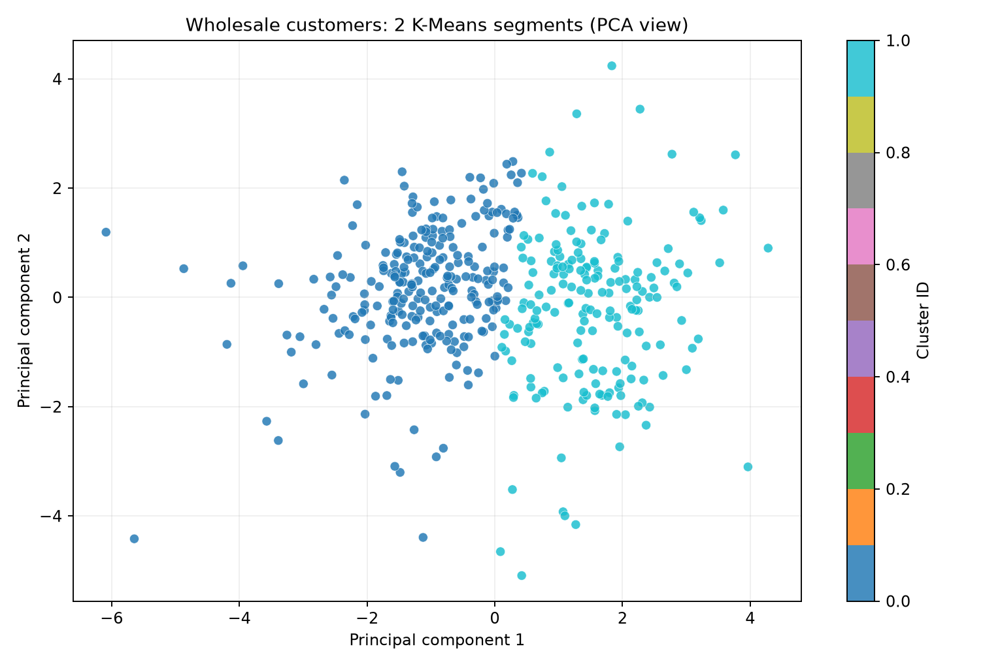

# Wholesale Customer Segmentation: Interactive Analytics

A business-focused unsupervised-learning project that groups wholesale customers by spending patterns. It combines a reproducible K-Means workflow with an interactive Streamlit dashboard for cluster selection, quality metrics, spending profiles, channel/region comparison, and new-customer assignment.

## What is included
- Validated UCI dataset with source and license attribution
- Log transform and standardization for skewed spending features
- Cluster-count comparison using inertia, silhouette, Davies-Bouldin, and Calinski-Harabasz metrics
- Cross-seed assignment stability using adjusted Rand agreement
- PCA visualization and interpretable spending signatures
- Dashboard for the bundled data or a compatible uploaded CSV
- New-customer prediction and downloadable assignment CSV

## Quick start
Python 3.11 or newer is recommended.

    python -m venv .venv
    python -m pip install -r requirements.txt
    python train.py
    streamlit run app.py

The dashboard analyzes the bundled data without pretraining. Training saves report files under results/ and a model under artifacts/ for command-line inference.

## Measured results
For the bundled 440-customer dataset, two clusters had the highest silhouette score among k=2 through k=8:

| Metric | Result |
| --- | ---: |
| Customers | 440 |
| Default clusters | 2 |
| Silhouette | 0.2903 |
| Davies-Bouldin | 1.3515 |
| Cross-seed stability ARI mean | 1.0000 |

The silhouette indicates modest separation, so the segments are exploratory. The ARI of 1.0 means the five alternate-seed runs produced the same partition up to cluster-label order.

## Use the model
After training, provide annual spend values in this order: Fresh, Milk, Grocery, Frozen, Detergents_Paper, Delicassen.

    python predict.py --spend 6000 800 9000 300 1000 250

Channel and Region are retained for description but excluded from fitting. The included UCI dataset is licensed CC BY 4.0; see data/README.md for attribution and the source link.

## How to read the dashboard
Choose a cluster count, inspect quality metrics, compare mean spending with the full dataset, review channel and region mix, and examine customers in a cluster. Cluster IDs are arbitrary. No single internal score proves that a grouping is useful.

## Limitations
This is a small historical sample from one wholesale distributor. Monetary units and collection context should not be generalized beyond the source. The dashboard is an analytical demonstration, not a validated marketing policy.
