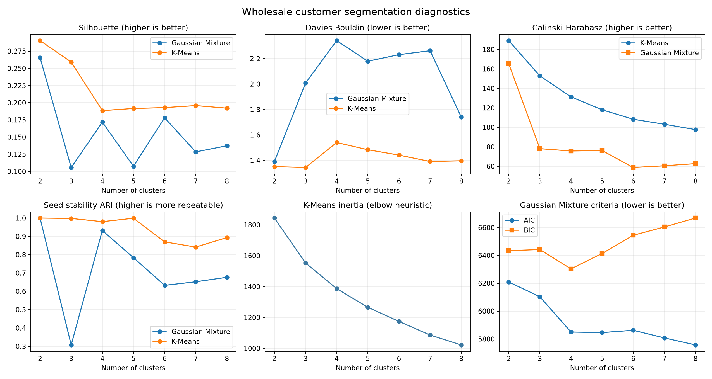

# Wholesale Customer Segmentation: Interactive Analytics

A business-focused unsupervised-learning project that groups wholesale customers by spending patterns. It compares K-Means with Gaussian Mixture Models, reports cluster quality and repeat-seed stability, and includes an interactive dashboard for customer profiles, channel/region analysis, and new-customer assignment.

## What is included
- Validated UCI dataset with source and license attribution
- Log transform and standardization for skewed spending features
- K-Means and Gaussian Mixture comparisons from two to eight clusters
- Silhouette, Davies-Bouldin, Calinski-Harabasz, inertia, AIC/BIC where applicable, and repeat-seed stability
- PCA visualization and interpretable spending signatures
- Dashboard for the bundled data or a compatible uploaded CSV
- New-customer prediction and downloadable assignment CSV

## Quick start
Python 3.11 or newer is recommended.

    python -m venv .venv
    python -m pip install -r requirements.txt
    python train.py
    streamlit run app.py

The dashboard analyzes the bundled data without pretraining. Training saves report files under results/ and a model under artifacts/ for command-line inference. K-Means gives hard assignments; Gaussian Mixture also estimates component membership probabilities.

## Measured results
For the bundled 440-customer dataset, the project compares both methods at k=2 through k=8. The default reproducible run uses K-Means with two clusters:

| Method (k=2) | Silhouette | Davies-Bouldin | Stability ARI |
| --- | ---: | ---: | ---: |
| K-Means | 0.2903 | 1.3515 | 1.0000 |
| Gaussian Mixture | 0.2656 | 1.3908 | 1.0000 |

K-Means at k=2 had the highest silhouette among the 14 method/count settings tested. The separation is modest, so these segments should be treated as exploratory. The five alternate-seed assignments matched the reference partition for both two-cluster methods.

These are descriptive diagnostics, not proof that the segments improve business outcomes. Compare the exported scorecard and inspect profiles before choosing a segmentation.

## Use the model
After training, provide annual spend values in this order: Fresh, Milk, Grocery, Frozen, Detergents_Paper, Delicassen.

    python predict.py --spend 6000 800 9000 300 1000 250

To train the probabilistic model, use `python train.py --algorithm "Gaussian Mixture" --clusters 2`. The app lets you select either method interactively.

Channel and Region are retained for description but excluded from fitting. The included UCI dataset is licensed CC BY 4.0; see data/README.md for attribution and the source link.

## How to read the dashboard
Choose a method and cluster count, inspect quality metrics, compare mean spending with the full dataset, review channel and region mix, and examine customers in a cluster. Gaussian Mixture also reports membership probabilities. Cluster IDs are arbitrary. No single internal score proves that a grouping is useful.

## Limitations
This is a small historical sample from one wholesale distributor. Monetary units and collection context should not be generalized beyond the source. The dashboard is an analytical demonstration, not a validated marketing policy.
